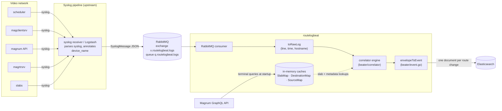
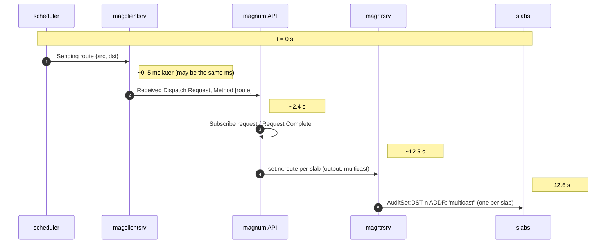
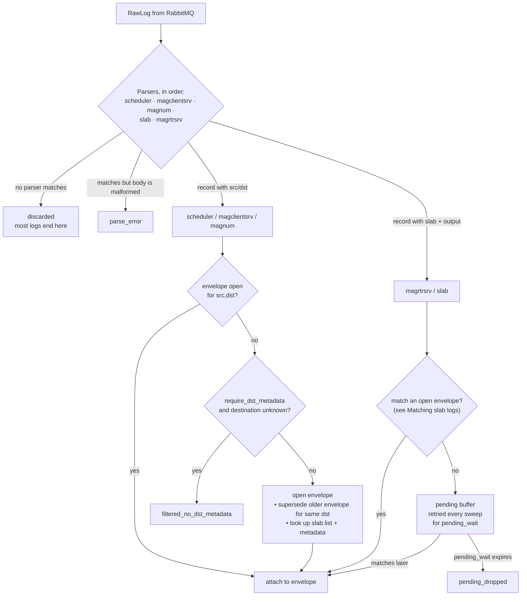
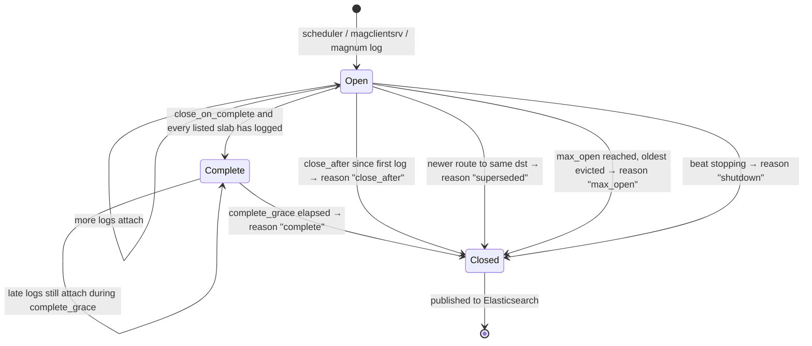
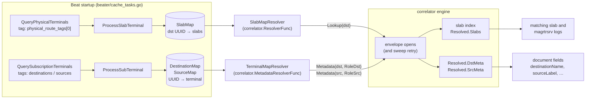

# routelogbeat

routelogbeat is an Elastic Beat that measures **how long a route change takes**
across a Magnum-controlled video network. A single route change is logged by
several services, in different formats, at different times: the scheduler,
the Magnum client server, the Magnum API, the Magnum router server and the
slabs (the devices that switch the multicast). routelogbeat receives those
logs in real time, works out which logs belong to the same route change, and
publishes **one Elasticsearch document per route change** with the route's
source and destination, every log that took part and the end-to-end duration.

- [How it works](#how-it-works)
- [The route logs](#the-route-logs)
- [The correlation engine](#the-correlation-engine)
- [Resolvers](#resolvers)
- [The published document](#the-published-document)
- [Configuration](#configuration)
- [Building and running](#building-and-running)
- [Monitoring and debugging](#monitoring-and-debugging)
- [Testing with the route syslog simulator](#testing-with-the-route-syslog-simulator)
- [Development](#development)
- [Known limitations](#known-limitations)

---

## How it works

### Architecture



1. Every service sends syslog to an upstream syslog pipeline (Logstash),
   which parses each message into a `SyslogMessage` JSON document, including
   `annotation.general.device_name`, and publishes it to RabbitMQ. The
   RabbitMQ output used there is in [`logstash/logstash.conf`](logstash/logstash.conf).
2. At startup routelogbeat queries the **Magnum GraphQL API** and fills three
   in-memory caches:
   - **SlabMap:** for each destination, the slab endpoints (slab hostname and
     output number) that carry it. These are terminals tagged with
     `physical_route_tags`.
   - **DestinationMap / SourceMap:** name, nameset label and tag for every
     terminal tagged with one of the `destinations` / `sources` tags.
3. routelogbeat consumes the queue and turns each message into a `RawLog`
   with three fields:
   - `Line`: `log.syslog.message`, the log text.
   - `Time`: `device.timestamp`, falling back to `@timestamp` and then to the
     current time.
   - `Hostname`: `annotation.general.device_name`.
4. The **correlator engine** recognises the route logs among everything else
   (most messages are unrelated and are discarded), groups the logs of each
   route change into an **envelope**, and closes the envelope on a timer.
5. Each closed envelope becomes one `beat.Event`, published through the
   configured libbeat output (Elasticsearch).

### Inside the beat

```
                 ┌──────────────────────────── routelogbeat ─────────────────────────────┐
                 │                                                                        │
  RabbitMQ ─────▶│  Run() loop ──Submit(RawLog)──▶ ┌──────────── correlator ────────────┐  │
  (JSON)         │     ▲                           │ single actor goroutine             │  │
                 │     │                           │  parsers → resolve → envelopes     │  │
                 │     │                           │  sweep timer → close → Events()    │  │
                 │     └──────── *Envelope ◀───────┤                                    │  │
                 │     │                           └──────▲──────────────────▲──────────┘  │
                 │     ▼                                  │ Lookup(dst)      │ Metadata()  │
                 │  envelopeToEvent ──▶ Publish ──▶ ES    │                  │             │
                 │                                 SlabMapResolver   TerminalMapResolver   │
                 │                                        ▲                  ▲             │
                 │                                    SlabMap      DestinationMap/SourceMap│
                 │                                        └──── Magnum GraphQL (startup) ──┘
                 └────────────────────────────────────────────────────────────────────────┘
```

The correlator package is self-contained: it imports only the Go standard
library and knows nothing about Magnum, RabbitMQ or libbeat. The beat hands it
two lookup functions over its caches:

- `SlabMapResolver(dstUUID) → []SlabRef`: which slabs carry this destination.
- `TerminalMapResolver(uuid, role) → map`: name, label and tag for a source
  or destination.

---

## The route logs

A route change from source `S` to destination `D` produces up to five kinds
of log. Only the scheduler, magclientsrv and magnum logs carry the route's
UUIDs; magrtrsrv and slab logs only name a slab and an output number.

| Log | Example (abridged) | Carries | Can open an envelope |
|---|---|---|---|
| **scheduler** (two formats) | `main: Sending route: [[{'src': ['S'], 'dst': ['D']}]]`<br/>`dcpipes.jsonrpctcp: SENDING: {'params': [[{'src': ['S'], 'dst': ['D']}]], 'method': 'route'}` | src, dst | yes (default opener) |
| **magclientsrv** | `INFO:interfaces.server:Received Dispatch Request. Client [10.103.40.46:45662], Message ID [44208], Method [route], Parameters [[[{'src': ['S'], 'dst': ['D']}]]].` | src, dst, client IP/port | yes, never partial |
| **magnum Subscribe request** (two shapes) | `INFO:jsonrpc:Subscribe request. Dst [('D',)], Sub [('S',)], ...`<br/>`INFO:jsonrpc:Subscribe request. Subscription [{'dst': ['D'], 'sub_dst': ['S']}], ...` | src, dst | yes (partial) |
| **magnum Request Complete** | `INFO:subscription:Subscription Request Complete: Routes [1-1]: [{'dst': ['D'], 'sub_dst': ['S']}]` | src, dst | yes (partial) |
| **magrtrsrv** | `INFO:commands:Cmd. D [1051], N [sv7bc-slab058], M [set.rx.route], A [[[{'dest': {'output': 4, ...}, 'sources': [{'multicast_ip': '239.32.111.55', ...}]}]]], K [{}]` | slab hostname, output, multicast | no |
| **slab** | `sv7bc-slab027 [23.08.2026 04:00:12.641] W: exlwrp-lwrp: info: ... AuditSet:DST 4 ADDR:"239.32.111.55;sync-time=3000"` | output, multicast (hostname from `device_name`) | no |

Only `Method [route]` magclientsrv logs are used; other methods are discarded.
Every UUID list must hold exactly one UUID, and a log with several route
objects produces one record per route.

A typical route change, from a captured sample:



magclientsrv logs are optional, and slab logs are often missing for
technical reasons even when magrtrsrv configured the route. The engine
handles every combination.

---

## The correlation engine

The engine lives in [`beater/correlator`](beater/correlator). One goroutine
owns all of its state, so there are no locks. Logs go in through `Submit`, and
closed envelopes come out on `Events()`.

### The envelope

An **envelope** collects every log of one route change. It is keyed by the
`(src, dst)` UUID pair.

```
 ┌─────────────────────────── Envelope  Key{Src: S, Dst: D} ───────────────────────────┐
 │ OpenedBy: scheduler        Partial: false          OpenedAt ──────────────▶ LastAt   │
 │                                                                                       │
 │ Records (arrival order)                                                               │
 │   scheduler      main: Sending route ...                              04:00:00.065   │
 │   magclientsrv   Received Dispatch Request ... Client [10.103.40.46:45662]  .069     │
 │   magnum_sub     Subscribe request. Dst [...] Sub [...]               04:00:02.506   │
 │   magnum_cmpl    Subscription Request Complete ...                    04:00:02.509   │
 │   magrtrsrv      N [sv7bc-slab027] output 4 multicast 239.32.111.55   04:00:12.600   │
 │   slab           sv7bc-slab027 AuditSet:DST 4 ADDR 239.32.111.55      04:00:12.641   │
 │   slab           sv7bc-slab058 AuditSet:DST 4 ADDR 239.32.111.55      04:00:12.653   │
 │                                                                                       │
 │ Resolved                                                                              │
 │   Slabs      [sv7bc-slab027:4, sv7bc-slab058:4]   ◀── SlabMapResolver(D) at open     │
 │   Multicast  239.32.111.55                         ◀── magrtrsrv (or first slab)      │
 │   ClientIP   10.103.40.46 : 45662                  ◀── first magclientsrv log        │
 │   SrcMeta / DstMeta  {id, name, label, tag}        ◀── TerminalMapResolver           │
 │                                                                                       │
 │ Reason: close_after | complete | superseded | max_open | shutdown                     │
 └───────────────────────────────────────────────────────────────────────────────────────┘
       Duration()               = LastAt − OpenedAt                     (first → last log)
       SchedulerToSlabMillis()  = last slab log − scheduler log          (→ durationMs)
```

### What happens to each log



Every `sweep_interval` the engine also:
- closes envelopes that have reached `close_after`, or that are complete
  when `close_on_complete` is on;
- retries the slab lookup for envelopes whose slab list was empty when they
  opened;
- retries, or drops, buffered slab and magrtrsrv logs.

### Matching slab and magrtrsrv logs

magrtrsrv and slab logs have no UUIDs, so they are matched through the slab
list of the envelopes that are currently open. When an envelope opens, the
engine asks the slab resolver for the destination's slabs (see
[Resolvers](#resolvers)) and indexes them:

```
   SlabMap cache (Magnum)                 engine slab index (open envelopes only)
   ─────────────────────────              ─────────────────────────────────────────
   D  → [slab027:4, slab058:4]   ──open──▶ {slab027, 4} → Key{S, D}
                                           {slab058, 4} → Key{S, D}

   incoming log                             lookup                     result
   ─────────────────────────────────────    ──────────────────────     ───────────────
   magrtrsrv  N [slab027] output 4 mc X  →  {slab027, 4} → Key{S,D}  →  attach; sets
                                                                        Multicast = X
   slab       slab058  DST 4  ADDR X     →  {slab058, 4} → Key{S,D}  →  multicast X == X
                                                                        → attach
   slab       slab058  DST 4  ADDR Y     →  {slab058, 4} → Key{S,D}  →  Y != X → pending
                                                                        (multicast_conflict)
   slab       slab099  DST 9  ADDR X     →  not in index             →  pending
                                                                        (no_slab_match)
```

The matching rule:

- **magrtrsrv** matches on slab hostname + output number. It is the most
  reliable source of the multicast, so it always sets the envelope's
  multicast.
- **slab** matches on hostname + output number, **and also on multicast once
  a magrtrsrv log has set one**. Without a magrtrsrv log, hostname + output
  is enough, and the first slab log fills in the multicast.
- magrtrsrv and slab logs **never open an envelope**. They can only join one
  that is already open (or opens within `pending_wait`).
- magrtrsrv's `output` is the same number as the slab's `DST n`.

### Opening, partial envelopes and supersession

| Situation | What happens |
|---|---|
| The `open_on` log (scheduler by default) arrives first | Opens a normal envelope |
| A **magclientsrv** log arrives first | Opens a normal envelope (not partial), even if no scheduler log ever arrives |
| A **magnum** log arrives first | Opens a **partial** envelope; a later scheduler or magclientsrv log clears `partial` |
| A new route arrives for the **same destination** with a **different source** | The older envelope closes immediately as `superseded` |
| The same `(src, dst)` is sent again while open | Joins the existing envelope; its timer does not restart |

### Closing



- By default an envelope closes **`close_after` after its first log**, however
  many logs have arrived. The duration is measured from the logs' own
  timestamps, so waiting longer only delays the document, not its numbers.
- With **`close_on_complete`**, an envelope closes early, after
  `complete_grace`, once every slab in its destination's slab list has sent a
  slab log. If a slab never logs, `close_after` still closes it.
- Envelopes still open when the beat stops are closed with reason `shutdown`
  and still published.

---

## Resolvers

The logs alone don't tell the engine two things it needs:

1. **Which slabs carry a destination.** Without this, a slab or magrtrsrv log
   (which names only a slab and an output number) can't be tied to a route.
2. **What the source and destination are called.** The logs carry only UUIDs.

The engine asks for both through two small interfaces, defined in
[`beater/correlator/resolver.go`](beater/correlator/resolver.go). The beat
implements them as functions over its Magnum caches. The correlator package
never talks to Magnum itself.



### Slab resolver

```go
type SlabRef struct {
    Hostname string // slab hostname, e.g. "sv7bc-slab027"
    DstNum   int    // output number, the "DST n" in the slab log
}

type Resolver interface {
    Lookup(dstUUID string) ([]SlabRef, bool)
}
```

Given a destination UUID, it returns the slabs that carry it, usually two and
sometimes one. It only works in that direction (destination → slabs), and it
never holds a multicast address; multicasts only ever come from logs.

**When the engine calls it:**

| When | Why |
|---|---|
| An envelope opens | To index the destination's slabs so its slab and magrtrsrv logs can match. The list is also kept on the envelope (`Resolved.Slabs`) and used by `close_on_complete` to decide when every expected slab has logged. |
| Every sweep, for open envelopes whose list was empty | The cache may catch up after the route started. Once the list arrives, buffered slab logs for it are matched straight away. |

If it has nothing for a destination, that route's slab and magrtrsrv logs
can't match. They are buffered, then dropped as `no_slab_match`, and the
debug hint says *"… open envelope(s) have no slab list: the resolver returned
nothing for their destination"*.

**The beat's implementation, `SlabMapResolver`,** reads SlabMap, which is
filled at startup from the Magnum terminals tagged with the first
`physical_route_tags` tag. Each slab terminal becomes one `SlabRef`:

```
  Magnum slab terminal (tag SLAB)          SlabMap                    must equal, in the logs
  ───────────────────────────────          ─────────────────          ─────────────────────────────────────
  subscribedSource.id   ────────────────▶  key: destination UUID      scheduler/magnum dst UUID
  port.device.name      ────────────────▶  SlabRef.Hostname     ◀──▶  slab log device_name, magrtrsrv N [...]
  port.id  "…,4"        ── last number ─▶  SlabRef.DstNum       ◀──▶  slab "AuditSet:DST 4", magrtrsrv 'output': 4
```

Terminals without a subscribed source are skipped. If the hostname or output
in Magnum doesn't match what the devices log, the slab logs won't correlate;
the debug hints call this out ("hostname is known but under DST# …").

### Metadata resolver

```go
type Role uint8 // RoleSrc or RoleDst

type MetadataResolver interface {
    Metadata(uuid string, role Role) (map[string]any, bool)
}
```

It returns details for one UUID as a map, which the engine stores on the
envelope without looking inside. `role` says whether the UUID is the route's
source or destination, so an implementation can keep separate caches.

**When the engine calls it:** once per envelope, when it opens. The
destination is looked up first; with `require_dst_metadata`, a miss there
discards the route before anything else happens, so it never supersedes or
evicts a real route. The source is looked up next. Neither is retried, so a
miss leaves those fields out of the document.

**The beat's implementation, `TerminalMapResolver`,** reads DestinationMap
for `RoleDst` and SourceMap for `RoleSrc`, and returns:

| Key | From | Document field |
|---|---|---|
| `id` | terminal ID | (not used; `destinationId`/`sourceId` come from the route's UUIDs) |
| `name` | terminal name | `destinationName` / `sourceName` |
| `label` | value in the `mapping.nameset` nameset, else `mapping.default` | `destinationLabel` / `sourceLabel` |
| `tag` | the `destinations` / `sources` tag it was cached under | `destinationTag` (sources have no tag field) |

### Using the resolvers in code

```go
// Adapt any function, e.g. a closure over a cache you already have.
slabs := correlator.ResolverFunc(func(dst string) ([]correlator.SlabRef, bool) {
    return myCache.SlabsFor(dst)
})
meta := correlator.MetadataResolverFunc(func(uuid string, role correlator.Role) (map[string]any, bool) {
    if role == correlator.RoleDst {
        return myCache.Destination(uuid)
    }
    return myCache.Source(uuid)
})

// Or use the built-in in-memory table (handy in tests).
table := correlator.NewMapResolver()
table.Store([]correlator.Entry{{
    DstUUID: "d113cd1e-ad09-5e1e-a278-21ff6914f9ce",
    Slabs:   []correlator.SlabRef{{Hostname: "sv7bc-slab027", DstNum: 4}, {Hostname: "sv7bc-slab058", DstNum: 4}},
}})
table.Upsert("another-dst-uuid", []correlator.SlabRef{{Hostname: "sv7bc-slab031", DstNum: 12}})

eng, err := correlator.New(cfg,
    correlator.WithResolver(slabs),       // or table
    correlator.WithMetadataResolver(meta),
)
```

Rules for any implementation:

- **Fast and local only.** Both are called on the engine's single goroutine,
  so a slow lookup (a network call, a contended lock) holds up every log
  behind it. Read from memory; fill the cache elsewhere.
- **Safe for concurrent use.** The engine reads while other code may be
  writing. `MapResolver` reads without locking (writes swap in a new table),
  and the beat's caches are concurrency-safe maps.
- **Both are optional.** Without a slab resolver, routes still correlate from
  their scheduler, magclientsrv and magnum logs, but slab and magrtrsrv logs
  never match. Without a metadata resolver, documents have no names, labels or
  tags, and `require_dst_metadata` is rejected when the engine starts.

The beat fills its caches only once, at startup, so a destination added in
Magnum later has no slab list or metadata until the beat restarts (see
[Known limitations](#known-limitations)).

---

## The published document

Each closed envelope becomes one document. Values that are unknown are
**left out** rather than set to `""` or `0`.

| Field | Type | Value | Left out when |
|---|---|---|---|
| `@timestamp` | date | First scheduler, magclientsrv or Subscribe request log (else the first log) | never |
| `destinationId` | keyword | Destination UUID | never |
| `destinationName`, `destinationLabel`, `destinationTag` | keyword | From DestinationMap (name, nameset label, tag) | destination not cached |
| `sourceId` | keyword | Source UUID | never |
| `sourceName`, `sourceLabel` | keyword | From SourceMap | source not cached |
| `clientIP` | ip | magclientsrv `Client [ip:port]` | no magclientsrv log |
| `durationMs` | long | Scheduler log → last slab log, in ms | no scheduler log or no slab log |
| `multicastAddress` | keyword | From magrtrsrv (or the slab log) | no magrtrsrv or slab log |
| `slabs[]` | `{slabName, slabOutput}` | Slabs that sent a slab log, ordered by first log time | no slab log |
| `matchedLogs[]` | `{log, time, type}` | Every correlated log (see order below) | never |
| `complete` | boolean | A magrtrsrv **or** slab log arrived (the route reached the slabs) | never |
| `partial` | boolean | Only magnum logs opened it (no scheduler or magclientsrv log) | never |

`matchedLogs` is always ordered **by type first, then by time** within each
type:

```
  1 scheduler → 2 magclientsrv → 3 magnum_subscribe → 4 magnum_complete → 5 magrtrsrv → 6 slab
```

Example:

```json
{
  "@timestamp": "2026-08-23T04:00:00.065Z",
  "destinationId": "d113cd1e-ad09-5e1e-a278-21ff6914f9ce",
  "destinationName": "MES-DST-014",
  "destinationLabel": "Studio 4 PGM",
  "destinationTag": "MES",
  "sourceId": "3fd8c558-c7dd-5ca4-8cb1-3f5d2a525c6f",
  "sourceName": "CAM-07",
  "sourceLabel": "Camera 7",
  "clientIP": "10.103.40.46",
  "durationMs": 12588,
  "multicastAddress": "239.32.111.55",
  "slabs": [
    { "slabName": "sv7bc-slab027", "slabOutput": 4 },
    { "slabName": "sv7bc-slab058", "slabOutput": 4 }
  ],
  "matchedLogs": [
    { "type": "scheduler",        "time": "2026-08-23T04:00:00.065Z", "log": "main: Sending route: [[{'src': [...], 'dst': [...]}]]" },
    { "type": "magclientsrv",     "time": "2026-08-23T04:00:00.069Z", "log": "INFO:interfaces.server:Received Dispatch Request. ..." },
    { "type": "magnum_subscribe", "time": "2026-08-23T04:00:02.506Z", "log": "INFO:jsonrpc:Subscribe request. ..." },
    { "type": "magnum_complete",  "time": "2026-08-23T04:00:02.509Z", "log": "INFO:subscription:Subscription Request Complete: ..." },
    { "type": "magrtrsrv",        "time": "2026-08-23T04:00:12.600Z", "log": "INFO:commands:Cmd. ... M [set.rx.route] ..." },
    { "type": "slab",             "time": "2026-08-23T04:00:12.641Z", "log": "sv7bc-slab027 [...] AuditSet:DST 4 ADDR:\"239.32.111.55;sync-time=3000\"" },
    { "type": "slab",             "time": "2026-08-23T04:00:12.653Z", "log": "sv7bc-slab058 [...] AuditSet:DST 4 ADDR:\"239.32.111.55;sync-time=3000\"" }
  ],
  "complete": true,
  "partial": false
}
```

The field mappings are defined in [`_meta/fields.yml`](_meta/fields.yml) and
generated into [`fields.yml`](fields.yml) and `include/fields.go`. A
hand-managed index template for `log-routelogbeat-*` is in
[`logstash/elasticsearch-template-routelogbeat.json`](logstash/elasticsearch-template-routelogbeat.json).

---

## Configuration

All settings live under `routelogbeat:` in [`routelogbeat.yml`](routelogbeat.yml).
The standard libbeat settings (`output.elasticsearch`, `logging`, `processors`,
…) work as in any beat; see
[`routelogbeat.reference.yml`](routelogbeat.reference.yml).

```yaml
routelogbeat:
  destinations: ["IPAN", "MES"]      # Magnum tags of the destinations to cache
  sources: ["SOURCE"]                # Magnum tags of the sources to cache
  physical_route_tags: ["SLAB"]      # Magnum tag of the slab terminals

  mapping:
    nameset: "Broadview"             # nameset used for destinationLabel/sourceLabel
    default: ""

  api:
    url: "https://<magnum-host>/graphql/v1.1"
    limit: 500                       # page size for terminal queries
    auth:
      client_id: "<client-id>"
      client_secret: "<client-secret>"
      token_url: "https://<magnum-host>/auth/realms/magnum/protocol/openid-connect/token"

  rabbitmq_client:
    host: "<rabbitmq-host>"
    port: 8910
    vhost: "/"
    username: "<user>"
    password: "<password>"
    exchange: "x.routelogbeat.logs"
    queue: "q.routelogbeat.logs"
    routing_key: "log.data"

  correlator:
    open_on: "scheduler"
    close_after: 2m
    sweep_interval: 1s
    max_open: 4096
    pending_wait: 5s
    require_dst_metadata: false
    close_on_complete: false
    complete_grace: 2s

output.elasticsearch:
  hosts: ["<elasticsearch-host>:9200"]
```

### Magnum and caches

| Setting | Default | Description |
|---|---|---|
| `destinations` | (required) | Magnum tags whose terminals are cached as destinations (DestinationMap). At least one is required. |
| `sources` | (required) | Magnum tags whose terminals are cached as sources (SourceMap). At least one is required. |
| `physical_route_tags` | (required) | Magnum tag of the slab terminals. Only the **first** tag is queried. This fills SlabMap, the destination → slab list lookup used to match slab and magrtrsrv logs. |
| `mapping.nameset` | | Nameset whose value becomes the terminal's label. Must not be empty when `mapping` is set. Treat `mapping` as required: the label lookup reads it. |
| `mapping.default` | `""` | Label used when a terminal has no value in that nameset. |
| `api.url` | | Magnum GraphQL endpoint. |
| `api.limit` | `500` | Page size for the paginated terminal queries. |
| `api.auth.client_id` / `client_secret` / `token_url` | | Magnum OIDC client credentials. The beat authenticates at startup and refreshes the token every 4 minutes. |

The caches are filled once, at startup, before any logs are processed.

### RabbitMQ

| Setting | Default | Description |
|---|---|---|
| `rabbitmq_client.host` / `port` | `localhost` / `8910` | Broker address. |
| `rabbitmq_client.vhost` | `/` | Virtual host. |
| `rabbitmq_client.username` / `password` | | Broker credentials. |
| `rabbitmq_client.exchange` | `x.routelogbeat.logs` | Direct, durable exchange the syslog pipeline publishes to. |
| `rabbitmq_client.queue` | `q.routelogbeat.logs` | Durable queue the beat consumes. |
| `rabbitmq_client.routing_key` | `log.data` | Binding key between the exchange and the queue. |

The client reconnects every 5 seconds if the broker is unavailable.

### Correlator

| Setting | Default | Description |
|---|---|---|
| `open_on` | `scheduler` | Log kind that opens a normal envelope: `scheduler`, `magnum_subscribe`, `magnum_complete` or `magclientsrv`. Other scheduler/magnum logs still open an envelope, marked **partial**. A magclientsrv log always opens a normal one. |
| `close_after` | `2m` | Fixed lifetime of an envelope, counted from its first log. The main close trigger; set it a little above your slowest normal route. |
| `sweep_interval` | `1s` | How often the engine closes due envelopes and retries buffered logs. Close times round up to this. |
| `max_open` | `4096` | Maximum envelopes open at once. When it is reached, the oldest is closed with reason `max_open`. |
| `pending_wait` | `5s` | How long a slab or magrtrsrv log that matches no open envelope is kept and retried before it is dropped. `0` drops it immediately. |
| `require_dst_metadata` | `false` | Only correlate routes whose destination is in DestinationMap, i.e. tagged with one of `destinations`. Other routes are discarded before an envelope opens (`filtered_no_dst_metadata`). |
| `close_on_complete` | `false` | Close an envelope early, with reason `complete`, once every slab in its destination's slab list has sent a slab log. `close_after` remains the upper bound. |
| `complete_grace` | `2s` | With `close_on_complete`, how long a complete envelope stays open for late logs before closing. `0` closes on the next sweep. |

> **Credentials.** Keep real secrets out of version control. libbeat supports
> environment variables (`password: "${RABBITMQ_PASSWORD}"`) and the beat
> keystore (`./routelogbeat keystore add RABBITMQ_PASSWORD`).

---

## Building and running

### Requirements

- Go 1.23+
- [mage](https://magefile.org/) (only for `mage build`/`mage fields`/packaging)
- Network access to RabbitMQ, the Magnum GraphQL API and Elasticsearch

### Build

```bash
go build -o routelogbeat .        # or: mage build
```

### Run

```bash
./routelogbeat -c routelogbeat.yml -e
```

`-e` logs to stderr. For correlator diagnostics, add `-d correlator` (see
[Monitoring and debugging](#monitoring-and-debugging)).

### Install as a service

[`logstash/systemd/routebeat.service`](logstash/systemd/routebeat.service) runs
the beat from `/opt/packages/routelogbeat` as user `insite`:

```bash
sudo cp logstash/systemd/routebeat.service /lib/systemd/system/routelogbeat.service
sudo systemctl daemon-reload
sudo systemctl enable --now routelogbeat
```

---

## Monitoring and debugging

### Log lines

Every closed envelope is logged:

```
routelogbeat: envelope closed src=… dst=… opened_by=scheduler partial=false logs=7
  sources=map[magclientsrv:1 magnum:2 magrtrsrv:1 scheduler:1 slab:2]
  duration=12.588s scheduler_to_slab=12588ms client=10.103.40.46:45662 reason=close_after
```

Correlator counters are logged once a minute and at shutdown:

```
correlator: submitted=… discarded=… parse_errors=… unresolved_slab=… (no_slab_match=… multicast_conflict=…)
  pending_dropped=… (no_slab_match=… multicast_conflict=…) filtered_no_dst_metadata=…
  envelopes_opened=… envelopes_closed=… (complete=…) open=… max_open_evictions=…
```

| Counter | Meaning |
|---|---|
| `discarded` | Logs no parser recognised. Expected to be most of the traffic. |
| `parse_errors` | Logs that looked like a route log but could not be parsed. |
| `unresolved_slab` | Slab or magrtrsrv logs that matched no open envelope when they arrived (buffered). |
| `pending_dropped` | Buffered logs that still matched nothing after `pending_wait`. |
| `no_slab_match` / `multicast_conflict` | Why: hostname + output not in any open envelope's slab list, or the slab's multicast disagrees with magrtrsrv's. |
| `filtered_no_dst_metadata` | Routes discarded by `require_dst_metadata`. |
| `complete` | Envelopes closed early by `close_on_complete`. |

### Why didn't a slab log correlate?

Enable the `correlator` debug selector:

```bash
./routelogbeat -c routelogbeat.yml -e -d correlator
```

or in `routelogbeat.yml`:

```yaml
logging.level: debug
logging.selectors: ["correlator"]
```

Each unmatched slab or magrtrsrv log is then logged once when it is buffered
and again if it is dropped. The log includes its hostname, output and
multicast, what the engine knew at the time, and a one-line hint, for example:

- *no envelope is open: no scheduler/magnum log opened one for this route, or
  it already closed (close_after)*
- *hostname is known but under DST# [3], not 4: the slab cache and the log
  disagree on the DST number*
- *N of M open envelope(s) have no slab list: the resolver returned nothing
  for their destination (is the slab cache populated for it?)*

---

## Testing with the route syslog simulator

[`scripts/route_syslog_sim.py`](scripts/route_syslog_sim.py) sends realistic
route-change syslog messages to your syslog receiver, with real delays, so you
can test the whole path end to end: syslog pipeline → RabbitMQ → routelogbeat
→ Elasticsearch. It needs only Python 3.

```
 route_syslog_sim.py ──UDP/TCP syslog──▶ syslog receiver ──▶ RabbitMQ ──▶ routelogbeat ──▶ Elasticsearch
```

For each route it sends, at these default offsets:

```
 t=0.000s   scheduler      main: Sending route: ...
 t=0.004s   magclientsrv   Received Dispatch Request. Client [ip:port] ... Method [route] ...
 t=2.441s   magnum         Subscribe request. ...
 t=2.444s   magnum         Subscription Request Complete: ...
 t=12.535s  magrtrsrv      set.rx.route (one per slab, 12 ms apart)
 t=12.576s  slab           AuditSet:DST <n> ADDR:"<multicast>" (one per slab, 12 ms apart)
```

Each slab log is sent with the slab's name as the syslog hostname, because
routelogbeat takes the slab hostname from `annotation.general.device_name`.
Check that your pipeline fills it in from the syslog hostname, not the
source IP.

### Quick start

```bash
cd scripts

# Preview, nothing is sent
./route_syslog_sim.py --dry-run

# One route, random UUIDs
./route_syslog_sim.py --target <syslog-host> --port 514

# A specific route
./route_syslog_sim.py --target <syslog-host> \
    --src 78fa211c-1e6c-5e5c-b697-1a4a7cbf5cb3 \
    --dst af2925a1-a72f-5355-a5d5-c3ec7f5de929 \
    --slab iad1bc-slab034:32 --slab iad1bc-slab015:32 \
    --multicast 239.131.1.163

# Several routes from a scenario file
./route_syslog_sim.py --target <syslog-host> --scenario route_scenario.example.json
```

For the slab logs to correlate, the destination UUID, slab names and outputs
must match what Magnum has for that destination (SlabMap). With
`require_dst_metadata: true`, the destination must also carry one of your
`destinations` tags.

### Options

| Group | Option | Default | Description |
|---|---|---|---|
| Receiver | `--target`, `--port` | `127.0.0.1`, `514` | Syslog receiver. |
| | `--proto` | `udp` | `udp` or `tcp`. |
| | `--octet-counting` | off | TCP: RFC 6587 octet-counting framing instead of newlines. |
| | `--format` | `rfc3164` | `rfc3164` or `rfc5424`; both use an ISO 8601 UTC timestamp with milliseconds. |
| | `--facility` | `local0` | Syslog facility. |
| | `--dry-run` | off | Print the messages and their offsets without sending. |
| Route | `--src`, `--dst` | random | Route UUIDs (reused for every route with `--count`). |
| | `--slab NAME:OUTPUT` | `sv7bc-slab027:4`, `sv7bc-slab058:4` | Slab and output number; repeat per slab. |
| | `--multicast` | `239.32.111.55` | Route multicast. |
| | `--slab-multicast` | | A different ADDR in the slab logs, to test `multicast_conflict`. |
| | `--client-ip`, `--client-port` | `10.103.40.46`, `45662` | magclientsrv client. |
| | `--udp-port`, `--source-ip` | `5004`, `10.12.42.89` | magrtrsrv details. |
| | `--scenario FILE` | | JSON file of routes (below). |
| Which logs | `--scheduler` | `v1` | `v1`, `v2` (dcpipes format) or `none`. |
| | `--no-magclientsrv` | off | Leave out the magclientsrv log. |
| | `--subscribe` | `dst_sub` | Subscribe request shape: `dst_sub`, `subscription` or `none`. |
| | `--no-complete` | off | Leave out Subscription Request Complete. |
| | `--magrtrsrv` | `all` | One magrtrsrv log per slab (`all`), only the `first` slab, or `none`. |
| | `--no-slab-logs` | off | Leave out slab logs (magrtrsrv logs are still sent). |
| Hostnames | `--scheduler-host`, `--magnum-host`, `--magclientsrv-host`, `--magrtrsrv-host` | `scheduler`, `magnum`, `magnum`, `magnum` | Syslog hostname per source (slab logs use the slab name). |
| | `--scheduler-tag`, `--magnum-tag`, `--magclientsrv-tag`, `--magrtrsrv-tag`, `--slab-tag` | `route-scheduler`, `magnum-api`, `magclientsrv`, `magrtrsrv`, `exlwrp` | Syslog process name. |
| Timing | `--count`, `--interval` | `1`, `20` | Number of routes and seconds between their starts (under ~12.6 s they overlap). |
| | `--scale` | `1.0` | Multiply every delay and start time, e.g. `0.1` for a fast run. |
| | `--jitter` | `0` | Random ± fraction on each gap; a route's own logs never reorder. |
| | `--seed` | | Repeatable jitter and UUIDs. |
| | `--at-scheduler`, `--at-magclientsrv`, `--at-subscribe`, `--at-complete`, `--at-magrtrsrv`, `--at-slab`, `--at-slab-gap` | see offsets above | Override one step's offset (seconds). |

### Scenario files

A scenario file lists routes. Any key left out falls back to the
command-line value.

```json
{
  "routes": [
    {
      "src": "78fa211c-1e6c-5e5c-b697-1a4a7cbf5cb3",
      "dst": "af2925a1-a72f-5355-a5d5-c3ec7f5de929",
      "multicast": "239.131.1.163",
      "slabs": [
        { "name": "iad1bc-slab034", "output": 32 },
        "iad1bc-slab015:32"
      ],
      "start": 0,
      "client_ip": "10.103.40.46",
      "client_port": 45662,
      "slab_multicast": "239.1.1.1",

      "scheduler": "none",
      "magclientsrv": true,
      "subscribe": "dst_sub",
      "complete": true,
      "magrtrsrv": "all",
      "slab_logs": false
    }
  ]
}
```

The last six keys choose which logs that route sends, with the same values as
the matching flags. Two examples are included:

| File | What it tests |
|---|---|
| [`route_scenario.example.json`](scripts/route_scenario.example.json) | Three complete routes, starting at 0 s, 5 s and 40 s |
| [`route_scenario.missing_logs.example.json`](scripts/route_scenario.missing_logs.example.json) | A route with no scheduler log (magclientsrv opens it) and routes with magrtrsrv but no slab logs (`complete: true`, no `durationMs`) |

### Useful test cases

| Goal | Command |
|---|---|
| Partial envelope (magnum opens it) | `--scheduler none --no-magclientsrv` |
| magclientsrv opens a normal envelope | `--scheduler none` |
| Route reaches magrtrsrv but no slab logs | `--no-slab-logs` |
| Multicast conflict | `--slab-multicast 239.1.1.1` |
| Supersession | Two routes in a scenario with the same `dst`, different `src` |
| Overlapping routes | `--count 5 --interval 3 --jitter 0.1` |
| `close_on_complete` | Turn it on; the document should arrive ~2–3 s after the last slab log instead of after `close_after` |

---

## Development

### Project layout

```
routelogbeat/
├── main.go, cmd/                 beat entry point
├── config/config.go              routelogbeat: settings and defaults
├── beater/
│   ├── routelogbeat.go           New / Run / Stop: wiring, publish loop, stats
│   ├── event.go                  envelope → Elasticsearch document
│   ├── cache_tasks.go            Magnum results → SlabMap / DestinationMap / SourceMap,
│   │                             SlabMapResolver, TerminalMapResolver
│   ├── correlator_debug.go       debug observer and hints for unmatched slab logs
│   ├── utils.go                  SyslogMessage → RawLog
│   ├── models.go, types.go       message and cache types
│   ├── cache/                    generic concurrent cache map
│   ├── magnumclient/             Magnum GraphQL client (paginated terminal queries)
│   ├── httpclient/               OIDC-authenticated HTTP client
│   ├── rabbitmqclient/           RabbitMQ consumer with reconnect
│   └── correlator/               the correlation engine (standard library only)
│       ├── correlator.go         Config, Engine, actor loop, open/attach/sweep/emit
│       ├── record.go             Kind, RawLog, Record, Envelope, durations
│       ├── parser*.go            one parser per log format
│       ├── resolver.go           Resolver / MetadataResolver interfaces, MapResolver
│       ├── debug.go, metrics.go  unmatched-log diagnostics, counters
│       └── *_test.go
├── _meta/fields.yml              Elasticsearch field definitions (source)
├── fields.yml, include/fields.go generated from _meta/fields.yml
├── _meta/config/*.tmpl           templates for the routelogbeat*.yml files
├── scripts/                      route syslog simulator and scenarios
└── logstash/                     RabbitMQ output config, index template, systemd unit
```

### Tests

```bash
go test ./... -race
```

The correlator tests use a fake clock, so timer behaviour is tested without
waiting. `beater/correlator/example_test.go` runs captured sample logs through
the engine end to end; `beater/event_test.go` covers the published document.

### Changing the Elasticsearch fields

Edit [`_meta/fields.yml`](_meta/fields.yml), then regenerate:

```bash
mage fields
go run "$(go list -m -f '{{.Dir}}' github.com/elastic/beats/v7)/dev-tools/cmd/asset/asset.go" \
    -license ASL2 -pkg include -in fields.yml -out include/fields.go routelogbeat
./routelogbeat export template -c "$PWD/routelogbeat.yml" | less   # check the mappings
```

Fields with sub-fields must be `type: group`. With `type: object`, libbeat
leaves the sub-fields out of the template.

> `mage update` also regenerates `routelogbeat.yml` from `_meta/config/*.tmpl`,
> which overwrites local settings in `routelogbeat.yml`. Use the commands above
> when you only need the fields.

### Adding a log format

Add a `Parser` in `beater/correlator` (a cheap `strings.Contains` check
first, then a regex), register it in `DefaultParsers()`, give it a `Kind`,
and add it to `matchedLogRank` in `beater/event.go`.

---

## Known limitations

- The caches are filled once at startup. Terminals added or changed in Magnum
  afterwards are not picked up until the beat restarts.
- Supersession goes by arrival order, not log time. If an older route's logs
  arrive after a newer route's first log for the same destination, the older
  route opens second and supersedes the newer one.
- With `require_dst_metadata`, slab and magrtrsrv logs for filtered
  destinations still count as `unresolved_slab` and `pending_dropped`.
- Only the first `physical_route_tags` tag is queried.
